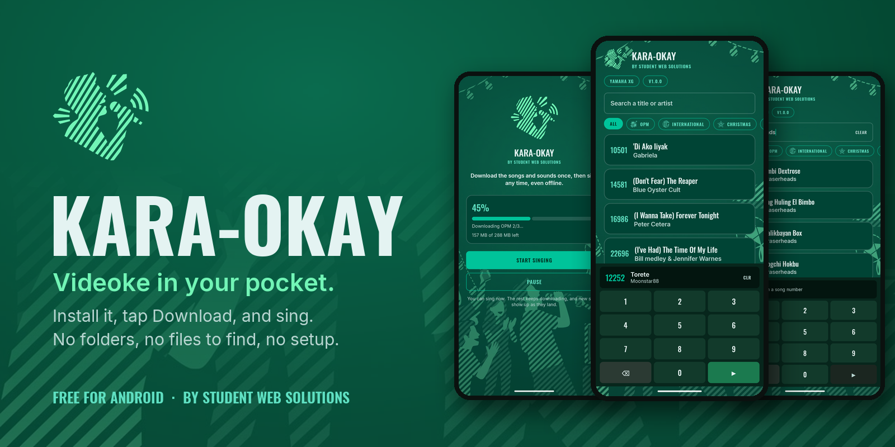
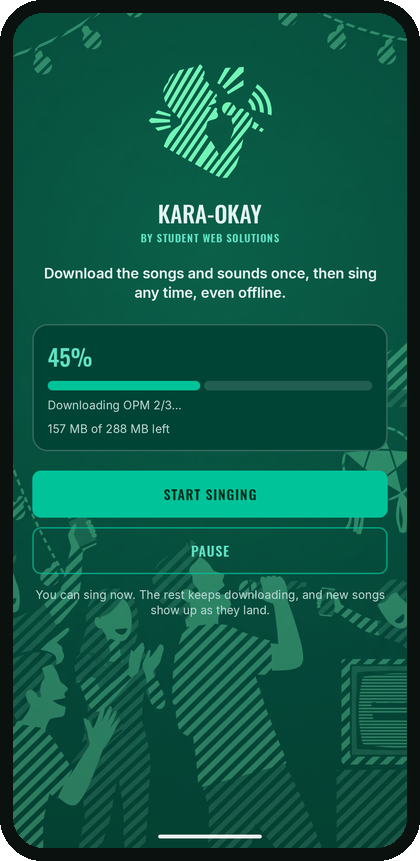
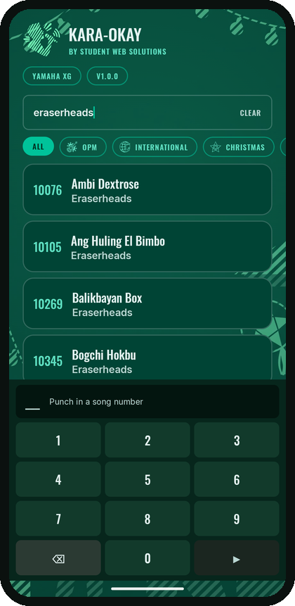
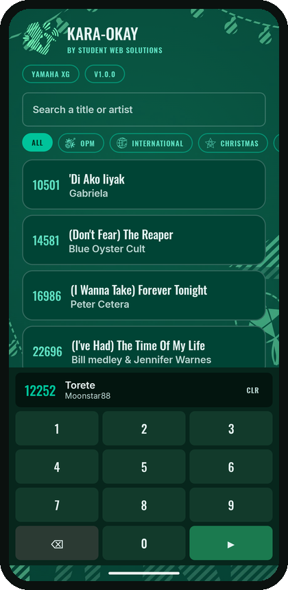
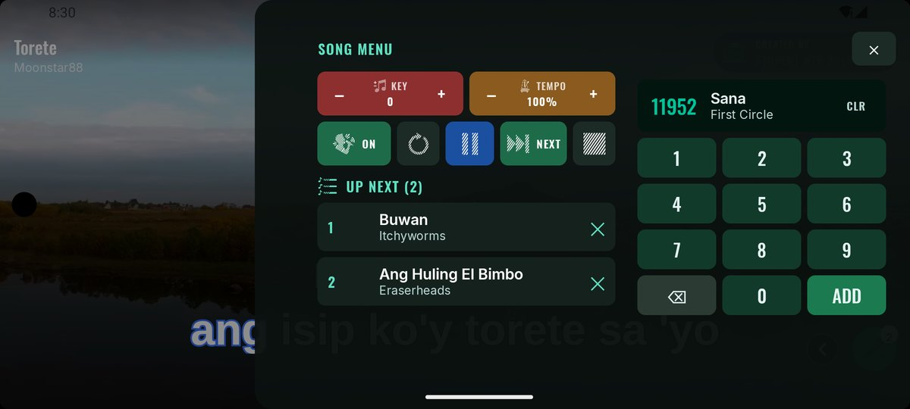
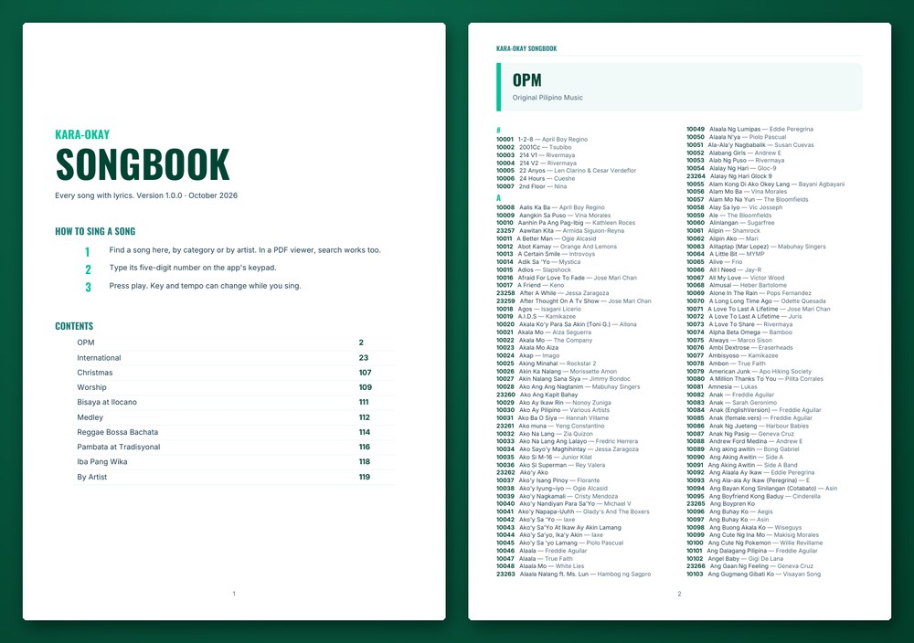

  

  
  
  
  
  

<h3 align="center">The Filipino videoke night, on your phone, TV and PC.</h3>

  Punch in a song number, sing to lyrics that colour as you go, and line up the next singer, 
  just like the machine at every party. No machine needed.

---

## ⬇️ Download (free)

| Where will you sing? | Get it here |
|---|---|
| 📱 **Android phone or tablet** | [**Kara-okay 1.8.0**](https://github.com/PrinceSanguan/KARA-OKAY/releases/latest): tap `Kara-okay-1.8.0.apk` under **Assets** |
| 📺 **Android TV or Google TV** | The same app: see [On a TV](#on-a-tv) below |
| 💻 **Windows laptop or PC** | [**Kara-okay PC 1.2.0**](https://github.com/PrinceSanguan/KARA-OKAY/releases/tag/pc-v1.2.0): click `Kara-okay-PC-Setup-1.2.0.exe` under **Assets** |

> **Tagalog:** Sa phone, buksan ang link sa **Chrome** (hindi sa loob ng Facebook o Messenger), i-tap ang `.apk`, tapos **Install**. Sa PC, i-click ang `.exe`, buksan, at kapag lumabas ang *"Windows protected your PC"*, i-click ang **More info → Run anyway**. Libre lahat, walang bayad.

## Why Kara-okay

Many karaoke apps hand you a player and leave the rest to you: find song files, find a soundfont, make the right folders, copy everything over, and hope it works. Kara-okay does all of that for you.

- **Install, tap one button, sing.** Songs, instrument sounds and video backdrops download inside the app. No file manager, no folders, nothing to copy.
- **Sing before it finishes.** The first songs are ready long before the download ends. The rest keeps coming in the background.
- **Made for Filipino parties.** More than 47,000 songs, each one checked: OPM, International, Christmas, Worship, Bisaya at Ilocano, Medley, Reggae · Bossa · Bachata, Pambata at Tradisyonal, and more, all with lyrics, the latest hits included.
- **Works like the real thing.** Every song has a five-digit number, a printable songbook, a keypad and a reserve list. If you have used a videoke machine, you already know how to use it.
- **Your own files, if you like.** Add your own songs, karaoke videos and sounds, or plug in a USB drive. No limit on how many.

## 🆕 New in 1.8 (phone and TV)

Kara-okay one point eight na! A new sound, lyrics in time with the music, and your requests. Salamat sa bawat comment at message!

| | |
|---|---|
| 🎹 **A new sound engine and a new sound, "Classic"** | Fuller, clearer music on every phone and TV. **Major** and **Dreamsam** are still one tap away in Sound. |
| 🎤 **Lyrics in time with the music** | Each word fills as it is sung, two lines at a time, with a 4-3-2-1 count-in. The words clear before the score, and the fanfare plays to the end, even with songs reserved. |
| 👀 **See-through titles and score** | No dark box over the video: the title, the ♪ INTERLUDE ♪ bar and the score show over it. Want the box, or no title? **Settings → Lyrics → Song title**. |
| 🎞️ **The background keeps playing** | Between songs too, and the next video comes when one ends. **BGV** changes it while you sing. New background videos too. |
| ⏹️ **Stop keeps your reservations** | Stop ends only the song playing and the next reserved song starts, as on a videoke. **Clear reserved** is in the Reserved list and in the Stop dialog. |
| 📃 **Playlists** | With Play all, Repeat this song, Repeat all and Shuffle. |
| 🧹 **Clear history** | In History. |
| 💾 **USB drive or SD card** | **Settings → Your songs → Add a USB or SD folder**. |
| 📺 **Old TV boxes** | Android 7 boxes can install it now. |
| 🔍 **Search in landscape** | The results show while you type, phone held sideways. |
| 🔦 **Flashlight and calculator** | Right in the app, at the top of **Settings**. |
| 🔢 **New song numbers** | Your favourites, history and playlists move to the new numbers by themselves. The songs download once more (about 490 MB). Make the new songbook with **Songbook (PDF)** at the top of **Settings**. |

Already on 1.1 or newer? Open Kara-okay and it offers the update. Your favourites, playlists and own songs stay.

## 💻 New: Kara-okay PC

Everything in the phone app, now on a Windows laptop or PC, plus what a phone can't do:

| | |
|---|---|
| 🎚️ **A mixer for every instrument** | Every instrument in the song has its own slider, mute and solo. Drums too loud? Turn just the drums down. |
| 🎤 **Two microphones** | Two mics, each with its own volume, echo and reverb. If a mic starts to howl, Kara-okay turns it down for you. |
| 💿 **DJ mode** | Press F3: two decks and a crossfader. Change the speed and the key while the song plays. |
| 🔁 **No gap between songs** | The reserved songs play one after another, with a fade or with no gap at all. |
| 🎧 **Headphones for the DJ** | Hear the next song in your headphones before the room does. |
| 📺 **Lyrics on the TV, buttons on the laptop** | Plug a TV into the laptop's HDMI. The lyrics show on the TV; the controls stay on the laptop. |
| 🎛️ **DJ controllers** | Hercules, Numark or any MIDI controller: plug it in, press **Learn**, and move a knob. |
| ⏺️ **Record to MP3** | Press Ctrl + R to record your singing. The MP3 goes to **Documents → Kara-okay → Recordings**. |
| 📱 **Guests' phones as the remote** | Guests scan the QR code on the screen and reserve or skip songs from their own phones. |

The same 47,000+ songs by number. Your own MIDI, KAR and MP3 songs, karaoke videos and `.sf2` sounds work too: just drag them onto the window. [How to install it](#on-a-windows-laptop-or-pc).

### 🆕 New in PC 1.2

Your comments on the Kara-okay PC videos, all answered, and everything new on the phone. Salamat!

| | |
|---|---|
| 🛠️ **Fixed from your comments** | Full screen has a way out (**Exit full screen**, **Esc**, **F11**), number keys and the numpad type (NumLock off too), search stays smooth on a long list, **Let phones connect** when Windows Firewall keeps phones out, and Find has a number row. |
| 📱 **The phone's 1.7 and 1.8** | Lyrics in time with the music and the **Classic** sound, the same song numbers as the phone (one songbook for all), a count-in, 11 lyric fonts and colours, see-through titles, Stop that keeps the reserved songs, the whole score fanfare, playlists and a calculator. |
| 📶 **Bluetooth remote** | No Wi-Fi? Up to 4 phones connect by Bluetooth: **Settings → TV and remote → No Wi-Fi? Phones can use Bluetooth**. |
| 🎹 **MIDI out for DJs** | Send the song to another program through loopMIDI, or to a sound module, in time with the lyrics and the key change: **Sound devices → MIDI out**. |

Already on PC 1.1.0? Open Kara-okay and it offers the update. Your own songs, favourites, playlists and settings stay; the songs download once more for their new numbers.

## Screenshots

  
  &nbsp;
  
  &nbsp;
  

  <b>Download once</b>, sing before it finishes &nbsp;·&nbsp; <b>Search</b> by title or artist &nbsp;·&nbsp; <b>Punch in</b> the song number

  

The stage: two lines at a time, coloured as you sing, over a moving backdrop.

  

The song menu: change the key or tempo, and queue the next songs by number while someone sings.

  

The printable songbook, by category and by artist, with every song's number.

## Features

| | |
|---|---|
| 🎤 **Videoke stage** | Lyrics that fill with colour as they are sung, in one of 11 fonts, a count-in before the first line, and moving video backdrops that carry on between songs. The song menu opens beside the lyrics, never over them. Long intros and breaks show ♪ INTERLUDE ♪ with a Skip. |
| 🔢 **Song numbers** | Every song has a five-digit number. Type it in the search box, on the keypad, on the phone remote or on the TV: a song shows from the first digit, and the keypad reads each digit back. |
| ⏭️ **Reserve, skip, sing now** | Reserve songs by number while someone else is singing; when a song ends, the next one starts by itself, and after the last one the stage waits on **Select a Song** for the next number. ⏭ skips to the next one, and ▶ beside Reserve sings a song now. Stop ends just this song and the next one reserved starts, as on a videoke; **Clear reserved** (on PC, **Stop all**) empties the list. |
| 🎚️ **Key, tempo and melody guide** | Move the key up or down, slow down or speed up the song, and turn the guide melody down, up or off. |
| 🔍 **Fast search, or just say it** | Search by title or artist, or tap the microphone and say it. A few letters show every match, closest first. Accents and apostrophes don't matter: `nino` finds *Niño*, `dont` finds *Don't*. |
| 🏆 **Singing score** | A score and a fanfare when each song ends. **For fun** works everywhere, even on a TV with no mic; **Mic** scores your real singing (on a TV, plug in a USB microphone or use your phone as the microphone). |
| ⏺️ **Record, and a camera** | Tap ● to record your singing (audio) into **My recordings**, to play or share. Turn on the camera behind the lyrics on a phone, tablet or a TV with a USB webcam: it is only shown, never recorded or sent. |
| 🎚️ **Sound mixer** | Bass, drums, melody and the rest of the band from 0 to 200%, bass boost, treble and echo, also while you sing. |
| ✍️ **Fix the lyrics yourself** | Change a song's words, move them earlier or later, or tap along to set each line. |
| 🎹 **Sound banks** | **Classic** plays every song, and **Major** and **Dreamsam** are one tap away in Sound. You can add your own `.sf2` sound, big ones too: each song loads only the instruments it plays, so it works on an everyday phone. Switch any time, even mid-song. |
| 📶 **Download once, sing offline** | About 750 MB on a phone or TV and about 800 MB on PC, downloaded once (Major and Dreamsam only if you want them). Pause it and resume later without losing anything. After that, no internet needed. |
| 📖 **Printable songbook** | A PDF songbook, by category and by artist, with every song's number, your own songs included. Make it in the app with **Songbook (PDF)** (on a phone, at the top of **Settings**), and print it for the party table. |
| 📺 **Android TV and phone remote** | The same app runs on Android TV and Google TV. Reserve songs and control the TV from your phone, with the lyrics on it too, or let guests scan a QR code with any phone, even while someone sings. Each reservation can carry the singer's name. No Wi-Fi? Use Bluetooth. No TV? Make a second phone the stage. |
| 🎵 **Your own songs too** | Add your own MIDI, KAR and MP3 songs (an MP3 with its `.lrc` lyrics), karaoke videos (MP4, MKV, WebM) and `.sf2` sounds. On a TV, send them from your phone. |
| 🎙️ **MP3 into karaoke** | Pick an MP3 from your phone: the singer's voice is taken out and the lyrics are found online, timed to the song. Works best on studio recordings. |
| 📁 **Your Kara-okay folder** | Turn it on and copy songs, karaoke videos, sounds and backgrounds into a Kara-okay folder with a file manager, a computer or a USB drive. They play from where they are: nothing copied, no limit. No access to all files on your TV box? Add a USB or SD folder with Android's own picker instead. |
| 🎨 **Make it yours** | Lyric size from 50% to 250%, 11 fonts, colour and outline; the background behind the lyrics, your own photos and videos included; and the app's colours: Green, Ocean blue, Purple night, Rose or Soft dark. |
| 🔄 **New songs by themselves** | When songs are added, they download on Wi-Fi with a **New** tag. Songs taken out go by themselves; yours are never touched. Updates to the app install from inside it. |
| 🔒 **No account, no ad networks** | No sign-up, no ad networks and no trackers. Sponsors who help keep it free are thanked by name. It never deletes your files or sends them anywhere. |

## Kara-okay vs SongHub

Kara-okay owes its start to **SongHub**, the father of karaoke apps on Android: without it, Kara-okay would not exist. Salamat, SongHub! 🙏

If you have used SongHub, you know it is a capable player, with extras like MP3 playback, Android TV and a phone remote. Its setup, though, is all on you. Kara-okay takes that setup away. It has Android TV, a phone remote and your own MIDI, KAR and MP3 songs too, and since 1.4.0 a Kara-okay folder you can fill with a file manager, the way SongHub users are used to.

| Getting to the first song | SongHub | Kara-okay |
|---|---|---|
| Song files | Find karaoke files yourself and copy them into a `SongHub/songs` folder | Downloaded inside the app with one tap |
| Instrument sound | Find an `.sf2` soundfont and copy it into `SongHub/sound` | Classic included, Major and Dreamsam one tap away |
| Folders to create | `SongHub/` with `songs/`, `sound/`, `bgv/`, `bgphoto/` and more | None (a Kara-okay folder only if you want one) |
| Backdrop videos | Copy your own into `bgv/` | Downloaded with the songs |
| When you can sing | After everything has been found and copied | Early in the first download, while the rest comes in |

*SongHub details are from its public project page. SongHub is a separate project with no connection to Kara-okay.*

## Install

### On a phone

1. **Open this page in Chrome** (not inside Facebook or Messenger). Open the [latest release](https://github.com/PrinceSanguan/KARA-OKAY/releases/latest) and tap **Kara-okay-1.8.0.apk** under **Assets**.
2. **Open the file** when it finishes downloading. If Android asks, allow Chrome to **install unknown apps**. Every app installed from outside the Play Store needs this once.
3. If **Google Play Protect** shows a warning, tap **More details → Install anyway**.
4. **Open Kara-okay** and, under **Ready to sing**, tap **Download songs**. Wi-Fi is best; on mobile data the app asks first. (Only want your own songs? Pick **My own songs**.)
5. When **Start singing** appears, you're ready. The rest keeps downloading in the background.

Already have an older version? Install the new one over it. **Your favourites, playlists and own songs stay.** Coming from 1.7 or older, the songs download once more for their new numbers.

### On a TV

For Android TV or Google TV:

1. Install the free **Downloader** app from the TV's Google Play.
2. Open it and type `github.com/PrinceSanguan/KARA-OKAY/releases/tag/v1.8.0`
3. Pick **Kara-okay-1.8.0.apk** and install it.
4. Open Kara-okay on the TV and, under **Ready to sing**, press **Download songs**.
5. To use your phone as the remote, scan the QR code on the TV's song list, or in its corner while a song plays.

### On a Windows laptop or PC

1. Open [Kara-okay PC 1.2.0](https://github.com/PrinceSanguan/KARA-OKAY/releases/tag/pc-v1.2.0) and click **Kara-okay-PC-Setup-1.2.0.exe** under **Assets** (124 MB).
2. Open the file. If Windows says **"Windows protected your PC"**, click **More info → Run anyway**. Kara-okay is new, so Windows doesn't know it yet. It is not a virus.
3. Pick **Install for all users**, and click **Yes** when Windows asks.
4. Click **Next** until **Install**, then **Finish**. Kara-okay opens and downloads the songs and sounds once (about 800 MB). After that, it works without internet.

**You need:**
- **Phone or TV:** Android 7.0 or newer, about 1.5 GB of free space (more with Major and Dreamsam).
- **PC:** Windows 10 or 11 (64-bit), about 1.5 GB of free space.
- Internet for the first download only.

## FAQ

<b>Is it free?</b>

 
Yes, on phone, TV and PC. Download it, install it, and sing. There is nothing to buy. If you would like to give something back, tap <b>♥ Support Kara-okay</b> on the song list for the GCash code: any amount is appreciated, and nothing changes if you don't.

<b>Is it safe to install?</b>

 
Yes. Kara-okay needs no account and has no ads. On a phone, it asks for internet (to download songs and to talk to the TV on your Wi-Fi), notifications (to show download progress) and your OK to install its own updates. The microphone is asked for only if you pick the <b>Mic</b> score or record your singing; a recording is made only when you tap ● and stays on your phone. The camera is asked for only if you turn on the camera behind the lyrics: it is shown on the screen, never recorded or sent. Bluetooth ("Nearby devices") is asked for only if you use the Bluetooth remote. Access to your files is asked for only if you turn on the <b>Kara-okay folder</b>, and it never deletes your files or sends them anywhere. It never asks for your contacts or location.
  
On a PC, Windows asks once for your OK while installing. Kara-okay PC records when you press <b>Ctrl + R</b>, and for <b>Instant replay</b>: the last three songs sung with a mic on, so you can hear them again. Both stay on your PC and are never sent anywhere; turn Instant replay off in <b>★ Tonight</b>.

<b>Windows says "Windows protected your PC". What do I do?</b>

 
Click <b>More info</b>, then <b>Run anyway</b>. Windows shows this for new apps it doesn't know yet; it goes away as more people install Kara-okay. It is not a virus. If you want to check the file, its SHA-256 is on the <a href="https://github.com/PrinceSanguan/KARA-OKAY/releases/tag/pc-v1.2.0">release page</a>.

<b>Does it need internet?</b>

 
Only for the first download, about 750 MB on a phone or TV and about 800 MB on PC (Major and Dreamsam only if you ask for them), and to find an MP3's lyrics online when you ask. After that it works fully offline, on phone, TV and PC.

<b>My download stopped. Do I start over?</b>

 
No. Tap <b>Resume</b> and it carries on from where it stopped. It also waits for the connection to come back on its own.

<b>How do I update?</b>

 
Kara-okay tells you when a new version is out and installs it for you, on the phone (from 1.1.0 on) and on the PC. On phone version 1.0.0, download the newer <code>.apk</code> from <a href="https://github.com/PrinceSanguan/KARA-OKAY/releases">Releases</a> and install it over the old one. Your downloaded songs stay.

<b>How do I show the lyrics on a TV from my laptop?</b>

 
Connect the TV to the laptop with an HDMI cable. Press <b>Windows key + P</b> and pick <b>Extend</b>. The lyrics go to the TV, and the buttons stay on the laptop. Want the sound from the TV's speakers? Click <b>Sound devices</b> at the top of Kara-okay and pick the TV.

<b>Can I add my own songs?</b>

 
Yes. On a phone, open <b>Settings → Your songs and sounds → Add songs</b> and pick <b>MIDI, KAR or MP3</b> files, or karaoke videos (<b>MP4, MKV, WebM</b>). For an MP3, pick its <b>.lrc</b> lyrics file too, with the same name, and the words show while you sing. You can add a <b>.sf2</b> sound there too. Your songs are under <b>My songs</b>, numbered from 90001. On a TV, use <b>Send from your phone</b>. On a PC, just drag the files onto the Kara-okay window.
  
Have lots of songs? On a phone, turn on the <b>Kara-okay folder</b> in the same place. Kara-okay makes a <code>Kara-okay</code> folder with <code>Songs</code>, <code>Videos</code>, <code>Sounds</code> and <code>Backgrounds</code> in it: copy your files in with any file manager or a computer, and they play from where they are, with no limit on how many. A <code>Kara-okay</code> folder on a USB drive works too. SongHub's <code>.idx</code> song packs can't be read: point Kara-okay at the MIDI or KAR files instead.

<b>Can I turn my MP3 into karaoke?</b>

 
Yes, since 1.5.0. Open <b>Settings → Your songs and sounds → Make an MP3 into karaoke</b> and pick an MP3 from your phone. Kara-okay takes the singer's voice out (<b>Voice: on / cut</b> in Controls while it plays) and finds the lyrics online, timed to the song; you pick the right one from the list. It works best on studio recordings; a live recording or a song with a lot of echo keeps some of the voice.

<b>How do I put it on my TV?</b>

 
On an Android TV or Google TV box, install the free <b>Downloader</b> app from the TV's Google Play. Open it, type <code>github.com/PrinceSanguan/KARA-OKAY/releases/tag/v1.8.0</code>, pick <code>Kara-okay-1.8.0.apk</code> and install it. Then open Kara-okay on the TV and download the songs once, the same as on a phone. Have a laptop instead? Use Kara-okay PC and an HDMI cable.

<b>Does the singing score work on a TV?</b>

 
Yes. Since 1.7.0 a TV gives a <b>For fun</b> score after every song with no mic at all. For a score from your real singing, pick <b>Mic</b> in <b>Controls → Score</b>. A TV has no microphone of its own, so plug a <b>USB microphone</b> into the TV box, or use your phone: open Kara-okay on the phone, connect it as the remote, and turn on <b>Score with this phone's mic</b>. Check it any time in <b>Settings → Singing → Test the microphone</b>.

<b>How do I use my phone as the remote?</b>

 
Put the phone and the TV (or PC) on the same Wi-Fi. The TV or PC shows a QR code: scan it with the phone's camera to reserve songs from the browser, with nothing to install. Or open Kara-okay on the phone, tap <b>Remote</b>, pick the TV or PC and type the 4-digit PIN shown on it. Some guest Wi-Fi networks keep devices apart; use the phone's hotspot then.
  
Guests can scan while someone sings: a small QR shows in the TV's corner during the intro and each interlude, and a big one any time from <b>Controls → Show the QR for phones</b>. Each guest's phone asks for a name once, shown on the TV with their song.
  
No Wi-Fi at all? Use Bluetooth: on the TV, <b>Settings → TV and remote → Bluetooth → Make visible</b>; on a PC, <b>Settings → TV and remote → No Wi-Fi? Phones can use Bluetooth</b> (pair a new phone with <b>Let a new phone find this PC</b>); on the phone, <b>Remote → Find by Bluetooth</b>. Up to 4 phones.
  
No TV? Since 1.6.0 a phone can be the stage too: on the phone that shows the lyrics, tap <b>Use this phone as the stage</b> on the song list, then connect the other phone the same way.

## Want your own version?

Kara-okay can be built for **your** business or event:

- **Videoke rentals, bars, resorts and events**, with your name, logo and colours
- **Your own song list and numbering**, and a songbook to match
- **Extra features** for how you run your nights

Send a message, and say what you have in mind:

  
  
  

Student Web Solutions also builds complete capstone and thesis systems for Filipino students: built, deployed and ready for defense.

## Made by

<table>
  <tr>
    <td></td>
    <td>
      <b>Prince E. Sanguan</b> · AI Full Stack Engineer · Silang, Cavite, Philippines 
      Builds production software end to end, from databases and AI pipelines to web, desktop and native mobile apps. 
      <a href="https://psanguan.com">psanguan.com</a> · <a href="https://www.linkedin.com/in/prince-sanguan-a78988274/">LinkedIn</a> · <a href="https://github.com/PrinceSanguan">GitHub</a>
    </td>
  </tr>
</table>

**Also by Prince:** *Biyaherong Chess Coach*, a chess coaching app with 10,000+ users, on [Google Play](https://play.google.com/store/apps/details?id=com.prince24pogi.biyaherongchessapp) and the [App Store](https://apps.apple.com/us/app/biyaherong-chess-coach/id6762338466).

## Credits and notices

Kara-okay is free to download and use. Its source code is not public.

It is built on these open-source projects, used unmodified:

- [FluidSynth](https://github.com/FluidSynth/fluidsynth), the software synthesizer, under the GNU LGPL 2.1: version 2.6.1 on Kara-okay PC, linked dynamically (and on Android until 1.7, from the [fluidsynth-android](https://github.com/VolcanoMobile/fluidsynth-android) build).
- [GeneralUser GS](https://github.com/mrbumpy409/GeneralUser-GS) by S. Christian Collins, the basic sound bank under the others, under the GeneralUser GS License v2.0.
- The Major and Dreamsam sound banks are custom-made by JC of the Filipino karaoke community. The Classic sound bank is reSAM 16 by DoReMi Channel / Baklas Electronics.
- [Inter](https://github.com/rsms/inter), [Oswald](https://github.com/googlefonts/OswaldFont) and [Arimo](https://github.com/googlefonts/arimo) fonts, under the SIL Open Font License 1.1, and the lyric fonts Atkinson Hyperlegible, Poppins, Barlow Semi Condensed, Archivo Black, Sniglet, Lilita One, Arvo, Comic Neue and Pacifico (SIL Open Font License 1.1) and Permanent Marker (Apache License 2.0).
- [Jetpack Compose, AndroidX (CameraX included), Media3 and WorkManager](https://developer.android.com/jetpack), under the Apache License 2.0.
- On PC also: [FFmpeg](https://ffmpeg.org) (GNU LGPL 3, as separate DLLs), [miniaudio](https://miniaud.io), [Signalsmith Stretch](https://signalsmith-audio.co.uk), Freeverb, [Eclipse Temurin](https://adoptium.net) (OpenJDK, GPL 2 with the Classpath Exception), [Kotlin and Compose Multiplatform](https://www.jetbrains.com/compose-multiplatform/), [RtMidi](https://github.com/thestk/rtmidi), JmDNS, SQLite JDBC, Apache PDFBox, Apache Commons Compress and the QR Code generator library by Project Nayuki. The full list, with every licence, is in the `licenses` folder where Kara-okay PC is installed.

Since 1.8 the phone and TV app plays with [BASS, BASSMIDI and BASS_FX](https://www.un4seen.com) by un4seen developments (not open source), used unmodified.

Lyrics found online for your own MP3s come from [LRCLIB](https://lrclib.net), a free, open lyrics library, and only when you ask.

Song titles and artist names belong to their respective owners.

   
  Made in the Philippines 🇵🇭 by <a href="https://studentwebsolutions.com">Student Web Solutions</a> · © 2026 Prince E. Sanguan

