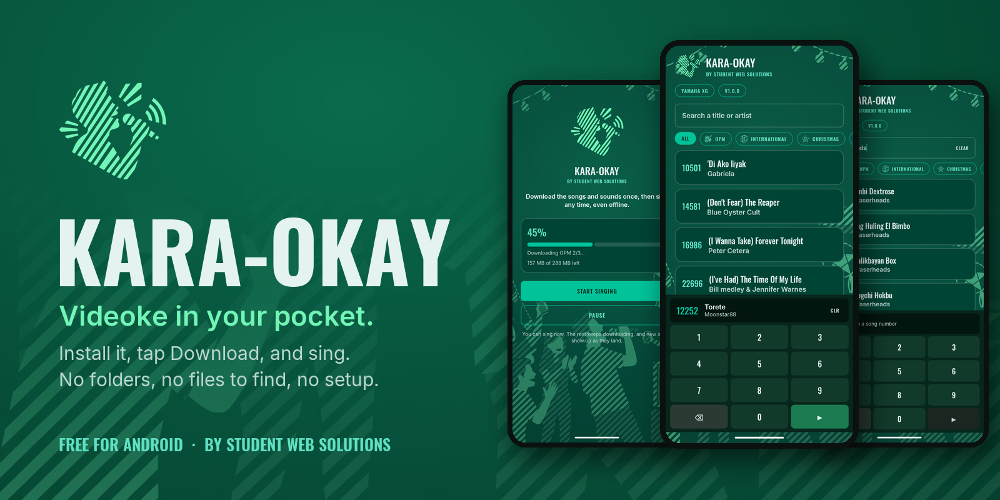
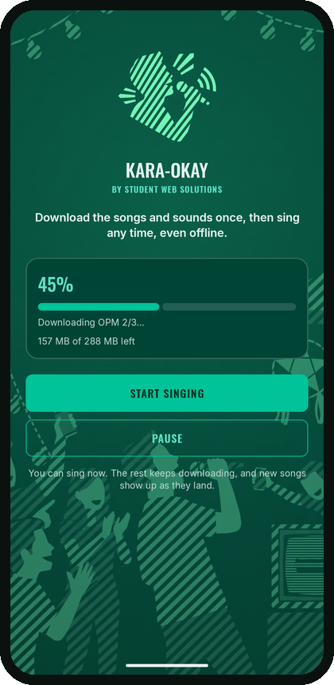
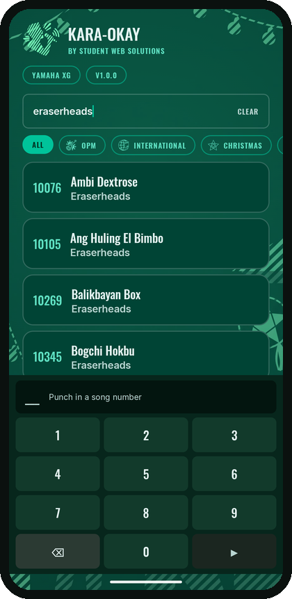
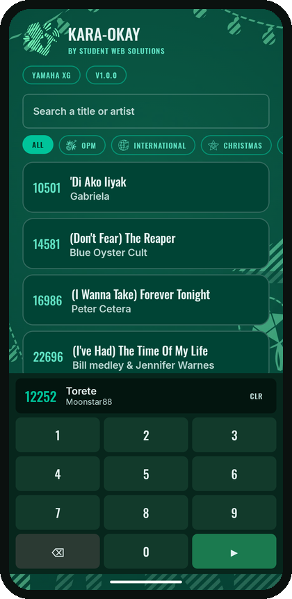
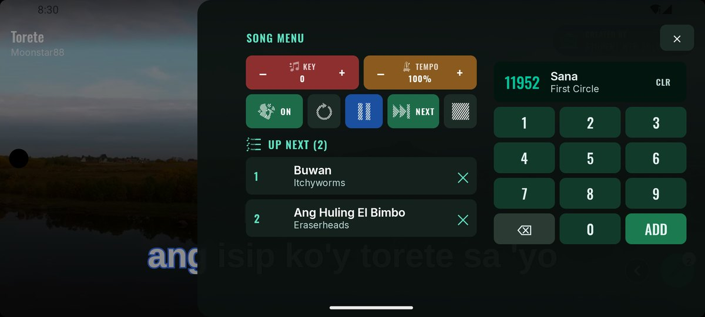
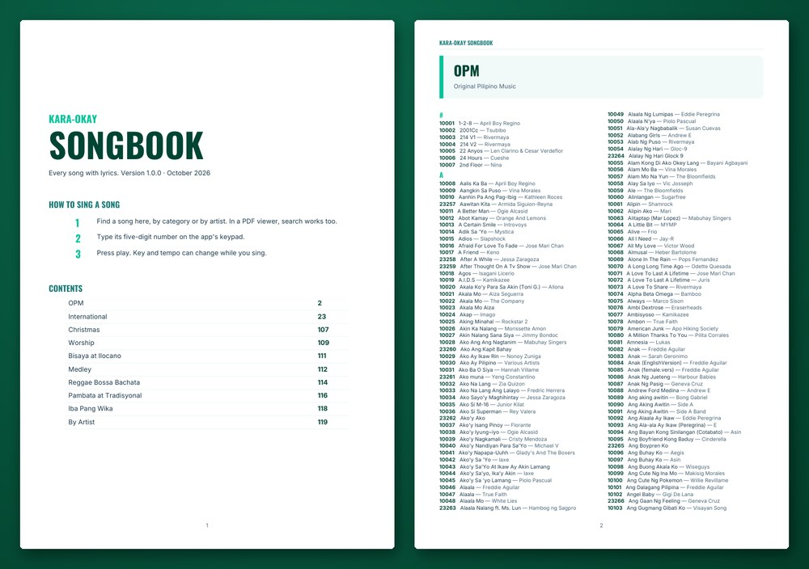

  

  
  
  
  

<h3 align="center">The Filipino videoke night, on your phone.</h3>

  Punch in a song number, sing to lyrics that colour as you go, and line up the next singer, 
  just like the machine at every party. No machine needed.

  <a href="../../releases/latest"><b>⬇️ Download Kara-okay for Android</b></a>

---

## Why Kara-okay

Many karaoke apps on Android hand you a player and leave the rest to you: find song files, find a soundfont, make the right folders, copy everything over, and hope it works. Kara-okay does all of that for you.

- **Install, tap one button, sing.** Songs, instrument sounds and video backdrops download inside the app. No file manager, no folders, nothing to copy.
- **Sing before it finishes.** The download is built so the first songs are ready at about 45%. The rest keeps coming in the background, and the list grows as it lands.
- **Made for Filipino parties.** OPM, International, Christmas, Worship, Bisaya at Ilocano, Medley, Reggae · Bossa · Bachata, Pambata at Tradisyonal, and more, all with lyrics.
- **Works like the real thing.** Every song has a five-digit number, a printable songbook, a keypad and an Up Next queue. Anyone who has used a videoke machine already knows how to use it.

## Screenshots

  
  &nbsp;
  
  &nbsp;
  

  <b>Download once</b>, sing at ~45% &nbsp;·&nbsp; <b>Search</b> by title or artist &nbsp;·&nbsp; <b>Punch in</b> the song number

  

The stage: two lines at a time, coloured as you sing, over a moving backdrop.

  

The song menu: change the key or tempo, and queue the next songs by number while someone sings.

  

The printable songbook, by category and by artist, with every song's number.

## Features

| | |
|---|---|
| 🎤 **Videoke stage** | Lyrics on two or three alternating lines that fill with colour as they are sung, a beat count-in before the first line, and moving video backdrops. The song menu opens beside the lyrics, never over them. |
| 🔢 **Song numbers** | Every song has a five-digit number. Type it in the search box, or on the keypad in the song menu, the phone remote or the TV; the keypad reads each digit back. |
| ⏭️ **Up Next queue** | Queue songs by number while someone else is singing. When a song ends, the next one starts on its own. |
| 🎚️ **Key, tempo and melody guide** | Move the key up or down six steps, slow down or speed up the song, and turn the guide melody on or off. |
| 🔍 **Fast search** | Search by title or artist. Accents and apostrophes don't matter: `nino` finds *Niño*, `dont` finds *Don't*. |
| 🎹 **Sound banks** | Two built-in instrument sets give the same song a different band, and you can add your own `.sf2`. Switch any time, even mid-song. |
| 📶 **Download once, sing offline** | About 290 MB, downloaded once. Pause it and resume later without losing anything; after that, no internet needed. |
| 📖 **Printable songbook** | A PDF songbook, by category and by artist, with every song's number. [Get it from Releases](../../releases/latest) and print it for the party table. |
| 📺 **Android TV and phone remote** | The same app runs on Android TV and Google TV. Reserve songs and control the TV from your phone, or let guests scan a QR code with any phone. |
| 🎵 **Your own songs too** | Add your own MIDI, KAR and MP3 songs (an MP3 with its `.lrc` lyrics) and `.sf2` sounds. On a TV, send them from your phone. |
| 🎨 **Make it yours** | Lyric size, colour and outline; the background behind the lyrics, your own photos and videos included; and the app's colours: Green, Ocean blue, Purple night, Rose or Soft dark, on a soft glow. |
| 🔄 **New songs by themselves** | When songs are added, they download on Wi-Fi with a **New** tag. Updates to the app install from inside it. |
| 🔒 **No account, no ads** | No sign-up and no ads. It asks for internet and notifications, and to install its own updates. |

## Kara-okay vs SongHub

If you have used SongHub on Android, you know it is a capable player, with extras like MP3 playback, Android TV and a phone remote. Its setup, though, is all on you. Kara-okay takes that setup away, and since 1.1.0 it has Android TV, a phone remote, and your own MIDI, KAR and MP3 songs too.

| Getting to the first song | SongHub | Kara-okay |
|---|---|---|
| Song files | Find karaoke files yourself and copy them into a `SongHub/songs` folder | Downloaded inside the app with one tap |
| Instrument sound | Find an `.sf2` soundfont and copy it into `SongHub/sound` | Two sound banks included |
| Folders to create | `SongHub/` with `songs/`, `sound/`, `bgv/`, `bgphoto/` and more | None |
| Backdrop videos | Copy your own into `bgv/` | Downloaded with the songs |
| When you can sing | After everything has been found and copied | At about 45% of the first download |

*SongHub details are from its public project page. SongHub is a separate project with no connection to Kara-okay.*

## Install

1. **On your phone**, open the [latest release](../../releases/latest) and tap the `.apk` file under **Assets**.
2. **Open the file** when it finishes downloading. If Android asks, allow your browser to **install unknown apps**. Every app installed from outside the Play Store needs this once.
3. If **Google Play Protect** shows a warning, tap **More details → Install anyway**.
4. **Open Kara-okay** and tap **Download songs**. Wi-Fi is best; on mobile data the app asks first.
5. When **Start singing** appears, you're ready. The rest keeps downloading in the background.

Already have an older version? Install the new one over it. **Your downloaded songs stay.**

**On a TV** (Android TV or Google TV):

1. Install the free **Downloader** app from the TV's Google Play.
2. Open it and type `github.com/PrinceSanguan/KARA-OKAY/releases/tag/v1.1.0`
3. Pick **Kara-okay-1.1.0.apk** and install it.
4. Open Kara-okay on the TV and tap **Download songs**.
5. To use your phone as the remote, scan the QR code on the TV's song list.

**You need:** Android 8.0 or newer, about 400 MB of free space, and internet for the first download only.

## FAQ

<b>Is it free?</b>

 
Yes. Download it, install it, and sing. There are no ads and nothing to buy.

<b>Is it safe to install?</b>

 
Kara-okay needs no account and has no ads. It asks for internet (to download songs and to talk to the TV on your Wi-Fi), notifications (to show download progress), and, the first time you update from inside the app, your OK to install its own updates. Your own photos, videos, songs and sounds are picked with Android's own pickers, so the app only ever sees the files you choose, and keeps a copy of them. It never asks for your storage, contacts or location. You can check under <b>Settings → Apps → Kara-okay → Permissions</b>.

<b>Does it need internet?</b>

 
Only for the first download, about 290 MB. After that it works fully offline.

<b>My download stopped. Do I start over?</b>

 
No. Tap <b>Resume</b> and it carries on from where it stopped. It also waits for the connection to come back on its own.

<b>How do I update?</b>

 
From 1.1.0 on, Kara-okay tells you when a new version is out and installs it for you. On 1.0.0, download the newer <code>.apk</code> from <a href="../../releases">Releases</a> and install it over the old one. Your downloaded songs stay.

<b>Can I add my own songs?</b>

 
Yes, since 1.1.0. Open <b>Settings → Your songs and sounds → Add songs</b> and pick <b>MIDI, KAR or MP3</b> files. For an MP3, pick its <b>.lrc</b> lyrics file too, with the same name, and the words show while you sing. You can also add a <b>.sf2</b> sound there. Your songs are under <b>My songs</b>, numbered from 90001. On a TV, use <b>Send from your phone</b>: scan the QR code and pick the files on your phone.

<b>How do I put it on my TV?</b>

 
On an Android TV or Google TV box, install the free <b>Downloader</b> app from the TV's Google Play. Open it, type <code>github.com/PrinceSanguan/KARA-OKAY/releases/tag/v1.1.0</code>, pick <code>Kara-okay-1.1.0.apk</code> and install it. Then open Kara-okay on the TV and download the songs once, the same as on a phone.

<b>How do I use my phone as the remote?</b>

 
Phone and TV on the same Wi-Fi. On the TV, the song list shows a QR code: scan it with the phone's camera to reserve songs from the browser, with nothing to install. Or open Kara-okay on the phone, tap <b>Remote</b>, pick the TV and type the 4-digit PIN shown on it. If the TV isn't listed, type the short code under the QR code. Some guest Wi-Fi networks keep devices apart; use the phone's hotspot for the TV then.

## Want your own version?

Kara-okay can be built for **your** business or event:

- **Videoke rentals, bars, resorts and events**, with your name, logo and colours
- **Your own song list and numbering**, and a songbook to match
- **Extra features** for how you run your nights

Send a message, and say what you have in mind:

  
  
  

Student Web Solutions also builds complete capstone and thesis systems for Filipino students: built, deployed and ready for defense.

## Made by

<table>
  <tr>
    <td></td>
    <td>
      <b>Prince E. Sanguan</b> · AI Full Stack Engineer · Silang, Cavite, Philippines 
      Builds production software end to end, from databases and AI pipelines to web and native mobile apps. 
      <a href="https://psanguan.com">psanguan.com</a> · <a href="https://www.linkedin.com/in/prince-sanguan-a78988274/">LinkedIn</a> · <a href="mailto:princesanguan44@gmail.com">princesanguan44@gmail.com</a>
    </td>
  </tr>
</table>

**Also by Prince:** *Biyaherong Chess Coach*, a chess coaching app with 10,000+ users, on [Google Play](https://play.google.com/store/apps/details?id=com.prince24pogi.biyaherongchessapp) and the [App Store](https://apps.apple.com/us/app/biyaherong-chess-coach/id6762338466).

## Credits and notices

Kara-okay is free to download and use. Its source code is not public.

It is built on these open-source projects, used unmodified:

- [FluidSynth](https://github.com/FluidSynth/fluidsynth) 2.4.6, the software synthesizer, under the GNU LGPL 2.1. Linked dynamically as `libfluidsynth.so`, from the [fluidsynth-android](https://github.com/VolcanoMobile/fluidsynth-android) build.
- [GeneralUser GS](https://github.com/mrbumpy409/GeneralUser-GS) by S. Christian Collins, one of the two sound banks, under the GeneralUser GS License v2.0.
- [Inter](https://github.com/rsms/inter), [Oswald](https://github.com/googlefonts/OswaldFont) and [Arimo](https://github.com/googlefonts/arimo) fonts, under the SIL Open Font License 1.1.
- [Jetpack Compose, AndroidX, Media3 and WorkManager](https://developer.android.com/jetpack), under the Apache License 2.0.

Song titles and artist names belong to their respective owners.

   
  Made in the Philippines 🇵🇭 by <a href="https://studentwebsolutions.com">Student Web Solutions</a> · © 2026 Prince E. Sanguan

